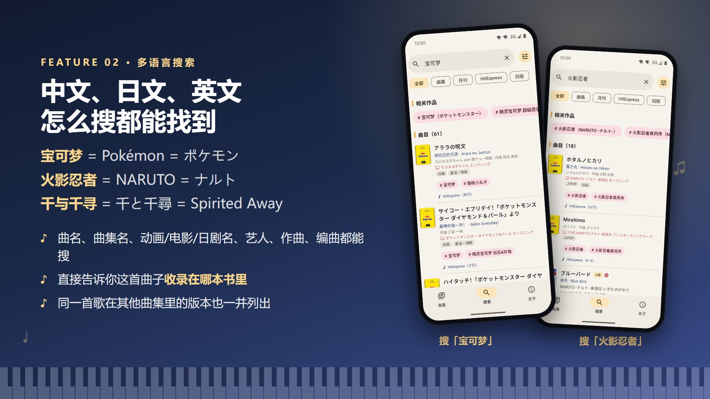

# 双排键曲集图鉴（Electone Atlas）

查询雅马哈双排键（エレクトーン）曲集和曲目的安卓 App：想弹的曲子在哪本书里，一搜就知道。

## 下载

👉 **[到 Releases 下载最新版 APK](../../releases/latest)**

每个版本都提供两个安装包，功能和内容完全一样，只有封面清晰度不同，任选一个：

| 安装包 | 封面 | 大小约 | 适合 |
|---|---|---|---|
| `ElectoneAtlas-v版本号-Lite.apk`（精简版，推荐） | 480×640 | 55 MB | 大多数人，省空间、下载快 |
| `ElectoneAtlas-v版本号-HD.apk`（高清版） | 720×960 | 108 MB | 想把封面放大看清细节 |

两个版本可以互相覆盖安装，想换的时候直接装另一个就行，不会丢数据。

- 支持 Android 8.0 及以上的手机、平板、折叠屏
- 第一次安装需要在手机上允许「安装未知来源应用」；已装旧版的直接覆盖安装即可
- 华为纯血鸿蒙（HarmonyOS NEXT / 5.0 及以后）不能直接安装 APK；HarmonyOS 4 及更早版本可以正常安装
- 目前仅支持 Android，计划将来提供 iOS 版

## 收录内容

- 2,528 本曲集、21,413 首曲目、75 个系列
- STAGEA / EL 全系列曲集，包括旧版、绝版书
- 月刊エレクトーン 1997–2026 共 344 期目录
- HitExpress / HitExpress2 单曲按月份整理

## 主要功能

**中日英都能搜**：宝可梦 / Pokémon / ポケモン、火影忍者 / NARUTO、千与千寻 / 千と千尋，怎么搜都能找到，并直接告诉你收录在哪本曲集。

**按难度、题材挑曲子**：按雅马哈级别（入门～上级）、29 种题材、出版年代、是否在售、是否有官方演示视频筛选，不输关键词也能直接浏览。

**月刊分层浏览**：年份 → 每一期 → 期内目录，每首曲目带级别和出处。

还有：
- 两万多首曲目标注了出处（动画、电影、日剧、广告、游戏……）、中英文名和题材标签
- 按 Vol 编号的系列按级别分组（5～3級 Vol.3 和 7～6級 Vol.3 分开显示）
- 曲集详情：首次出版日期、再版改版记录、级别、对应机型、商品编号、在售状态
- 深色模式

## 作者

由 B 站 UP 主 [炎舞星辉-仙布酱](https://space.bilibili.com/3494370663729231) 制作。想要的功能、发现的问题，欢迎在 B 站告诉我，或者在这里提 [Issue](../../issues)。

---

非雅马哈官方应用。「エレクトーン」「STAGEA」为雅马哈株式会社注册商标；封面与曲目信息的版权归各权利人所有。
